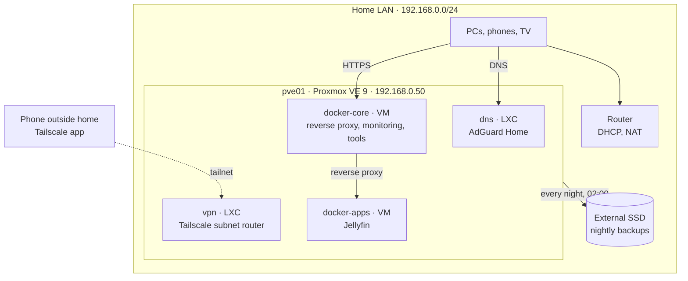

# Home Server

The home server I run at my place. It's not a fake company lab: it's stuff my household actually uses every day. Network-wide ad blocking, a VPN to get home from anywhere, a media server, HTTPS for every service, monitoring that pings my phone when something breaks, and nightly backups.

I built it to learn Docker properly and to practise what I'm studying: networking, Linux, DNS, TLS and backups. Every phase is documented so someone else could rebuild it from scratch, including the parts where I messed up.

> **Status:** in progress. Proxmox and AdGuard Home are running; Tailscale is next. See the [roadmap](#roadmap).

## Architecture



## Hardware

| Machine | Specs | Role |
|---|---|---|
| Acer Aspire C27 (all-in-one) | Intel i5-1035G1, 24 GB RAM, 512 GB NVMe SSD | Proxmox VE host, runs everything |
| External SSD | USB 3 | Nightly backups of every VM and container |
| Router | | DHCP, NAT, behind the ISP modem (double NAT) |

## How it's split up

| Name | Type | IP | RAM | Disk | What runs on it |
|---|---|---|---|---|---|
| `pve01` | Proxmox VE host | 192.168.0.50 | ~2 GB | 512 GB NVMe | Hypervisor |
| `dns` | LXC (Debian 13) | 192.168.0.11 | 512 MB | 4 GB | AdGuard Home |
| `vpn` | LXC (Debian 13) | 192.168.0.12 | 256 MB | 4 GB | Tailscale subnet router |
| `docker-core` | VM (Debian 13) | 192.168.0.20 | 4 GB | 60 GB | 9 always-on services |
| `docker-apps` | VM (Debian 13) | 192.168.0.21 | 4 GB | 80 GB + 200 GB media | Jellyfin + agents |

Why this layout:

- **DNS and VPN are in their own LXCs**, not in Docker. If I break a Docker VM, the house still has internet and I can still reach the server remotely.
- **Two Docker VMs**, so a heavy app (Jellyfin transcoding) can't take down the reverse proxy or the monitoring.
- **About 13 GB of RAM stays free** on the host for other labs.

## Services

| Service | Runs on | What I use it for |
|---|---|---|
| AdGuard Home | `dns` | DNS and ad blocking for every device on the network |
| Tailscale | `vpn` | Reach the LAN from anywhere, no port forwarding |
| Nginx Proxy Manager | `docker-core` | One HTTPS entry point: `*.home.<domain>` with a wildcard Let's Encrypt certificate (DNS-01 through Cloudflare) |
| Uptime Kuma | `docker-core` | Checks every service is up |
| ntfy | `docker-core` | Push notifications to my phone. Everything sends its alerts here |
| Dozzle | `docker-core` + agent on `docker-apps` | Live container logs from both VMs in the browser |
| Diun | both VMs | Tells me when an image has an update. It doesn't auto-update, on purpose |
| NetAlertX | `docker-core` | Scans the LAN and alerts me when a new device joins |
| Homepage | `docker-core` | Dashboard with every service and its status |
| SearXNG | `docker-core` | Private search engine |
| IT-Tools | `docker-core` | Subnet calculator, hashes, base64 and more |
| Jellyfin | `docker-apps` | Movies, shows and music |

Compose files for every service are in [`stacks/`](stacks/).

## Security choices

- **Nothing is port-forwarded.** Remote access only goes through Tailscale.
- Admin interfaces (Proxmox, AdGuard, Nginx Proxy Manager, Dozzle) are only reachable on the LAN or over the VPN.
- Every service gets a trusted HTTPS certificate without exposing anything: the DNS-01 challenge needs no public DNS record and no open port.
- Proxmox `root` is protected with TOTP two-factor; the VMs accept SSH keys only, no passwords.
- Tools that only read Docker mount the socket read-only.
- Secrets live in `.env` files that are git-ignored. This repo only contains `.env.example` files.

## Backups

| Copy | Where | How often |
|---|---|---|
| 1 | External SSD on the host (keeps 7 daily + 4 weekly) | Every night, 02:00 |
| 2 | USB drive kept outside the house | Monthly |
| Config | This repo | Every change |

A failed backup sends an alert to my phone. I test a restore every month: a backup I've never restored is just a guess.

## Repo layout

```
.
├── docs/            one write-up per phase: what I did, what broke, how I fixed it
├── screenshots/     proof it actually runs
└── stacks/
    ├── docker-core/ one folder per service, each with a compose.yaml
    └── docker-apps/
```

## Roadmap

- [x] Phase 0 – Planning (IP plan, hardware, service list)
- [x] Phase 1 – Proxmox install + base config
- [x] Phase 2 – [AdGuard Home](docs/02-adguard-home.md)
- [ ] Phase 3 – Tailscale subnet router *(next)*
- [ ] Phase 4 – Docker VMs
- [ ] Phase 4B – Nightly backups to the external SSD
- [ ] Phase 5 – First containers (Uptime Kuma, Dozzle)
- [ ] Phase 6 – Monitoring and alerts (ntfy, Diun, NetAlertX, Proxmox alerts)
- [ ] Phase 7 – Domain, HTTPS, reverse proxy
- [ ] Phase 8 – Daily tools (IT-Tools, SearXNG, Homepage)
- [ ] Phase 9 – Jellyfin
- [ ] Phase 10 – Updates, restore tests, maintenance routine
- [ ] Later – a second backup machine (an old PC running Proxmox Backup Server)

## What I learned

I'll fill this in as I go. The detailed notes are in [`docs/`](docs/).

## About me

I'm Olivier, a student in the DEP Soutien informatique at CFP des Riverains (Quebec). I'm into networking, cybersecurity and cloud, and I'm working toward the CCNA.

- GitHub: [@Olivier9-Dev](https://github.com/Olivier9-Dev)
