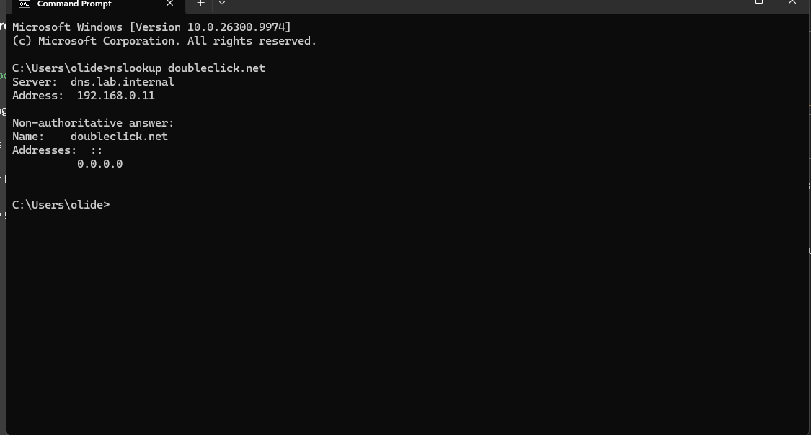
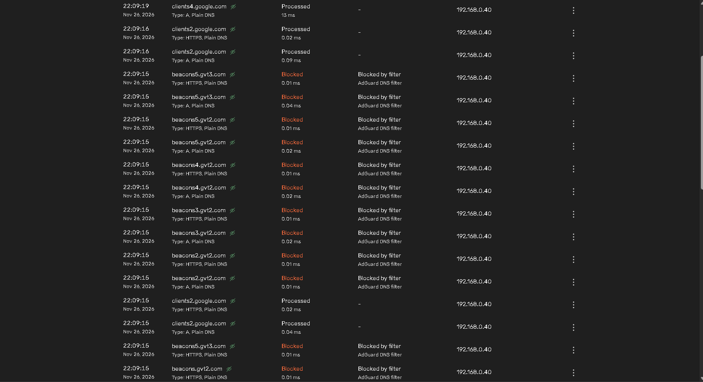
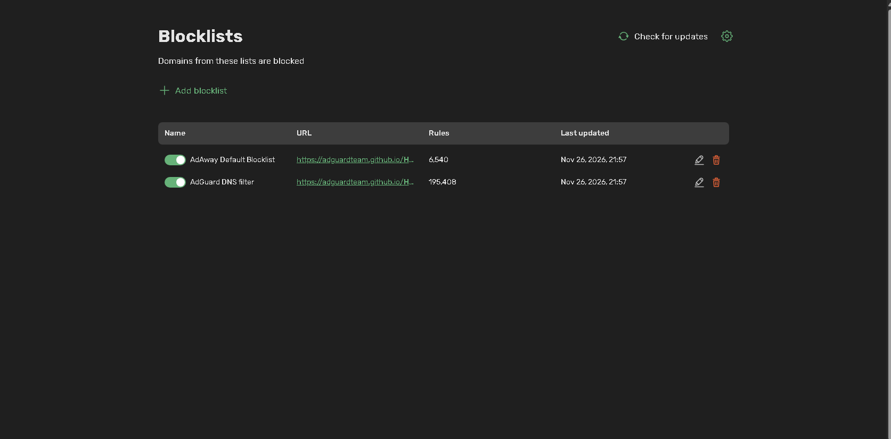
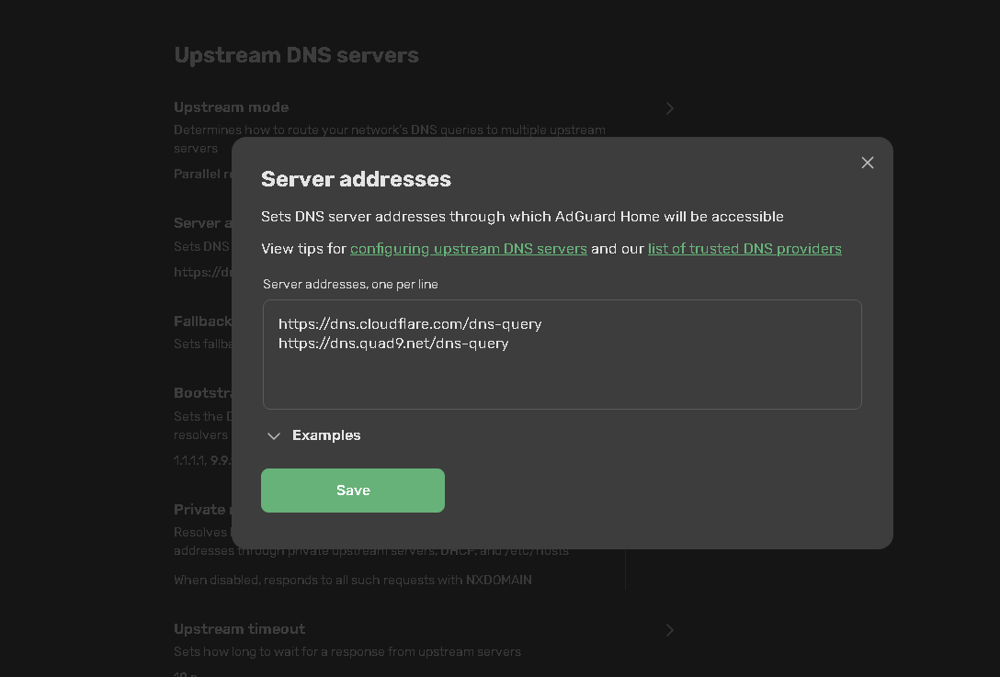
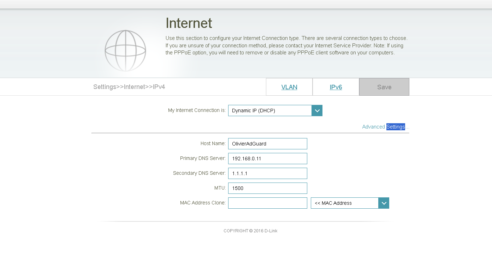

# Phase 2 – AdGuard Home

## Goal

One DNS server for the whole house that blocks ads and trackers on every device (phones and TV included) without installing anything on them.

## What I did

- Created an unprivileged Debian 13 LXC on Proxmox: `dns`, CT 101, static IP `192.168.0.11`.
- Installed AdGuard Home with the official install script. It runs as a systemd service.

```bash
# On the Proxmox host
pct enter 101

# Inside the container
apt update && apt full-upgrade -y
apt install -y curl
curl -s -S -L https://raw.githubusercontent.com/AdguardTeam/AdGuardHome/master/scripts/install.sh | sh -s -- -v
systemctl status AdGuardHome --no-pager
```

- **Upstream DNS:** Cloudflare and Quad9 over DNS-over-HTTPS, in parallel mode, with `1.1.1.1` and `9.9.9.9` as bootstrap. My devices use plain DNS on the LAN, but everything that leaves the house is encrypted, so my ISP can't see which names we look up.
- **Blocklists:** AdGuard DNS filter (195,408 rules) and AdAway Default Blocklist (6,540 rules, mostly mobile app ads).
- **Router (D-Link):** primary DNS `192.168.0.11`, secondary `1.1.1.1`. The secondary keeps the internet working if the container goes down, at the cost of some queries skipping the filter.

## How it works

Before a device connects anywhere, it has to ask "what's the IP address of this name?" When a phone joins the Wi-Fi, the router's DHCP tells it to ask `192.168.0.11`, so every device sends its questions to AdGuard without any setup on the device.

AdGuard checks each name against its blocklists. Normal names get their real address. Ad and tracker names like `doubleclick.net` get `0.0.0.0` instead, so the connection fails, the ad never shows up, and the page loads faster.

**The limit:** DNS blocking works per domain name. Twitch and YouTube serve their ads from the same domain as the video, so blocking the ad would also block the stream. For those sites you need a blocker that works inside the page, like the uBlock Origin browser extension.

## What broke

| Problem | Error / symptom | Fix |
|---|---|---|
| Locked out of the admin page | Too many wrong passwords, login blocked for 15 minutes | The lockout is only kept in memory: `systemctl restart AdGuardHome` in the container cleared it right away |
| Nothing was getting blocked | Dashboard showed 0 blocked ads, and the top domain was `dns.google` | Chrome's **Secure DNS** was sending my lookups straight to Google over HTTPS, around AdGuard. Turned it off. Android's **Private DNS** does the same thing on phones |

## Proof

`doubleclick.net` resolves to `0.0.0.0` (blocked), and the answer comes from `192.168.0.11`:



Query log: Chrome's tracking beacons blocked by the AdGuard DNS filter, normal Google domains still processed:



Blocklists:



Encrypted upstream DNS servers:



Router pointing the whole network at AdGuard:


