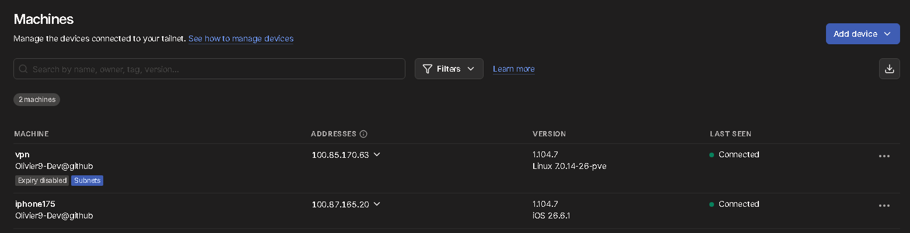
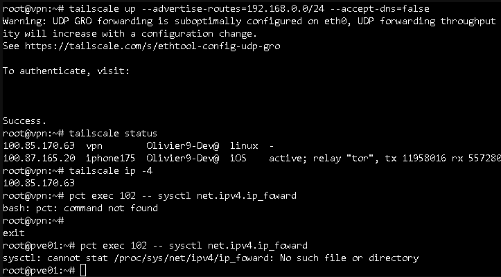
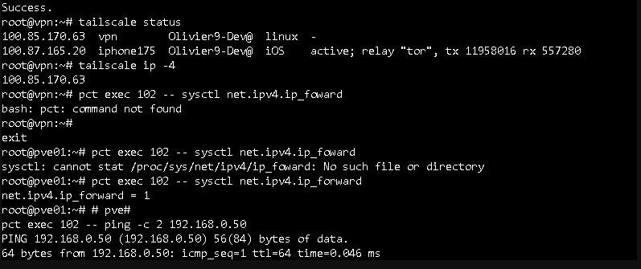
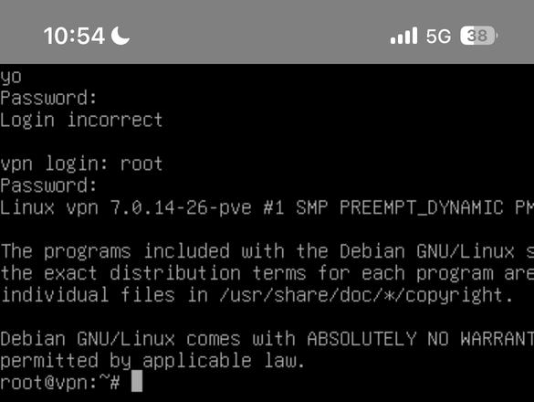
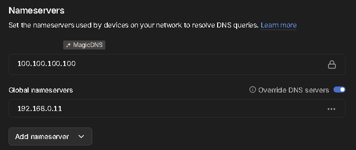

# Phase 3 – Tailscale subnet router

## Goal

Reach every device on my home network from anywhere (school, or my phone on 5G) without opening a single port on the router, even behind double NAT.

## What I did

- Created an unprivileged Debian 13 LXC: `vpn`, CT 102, static IP `192.168.0.12`. Tailscale needs a TUN device to create its network interface, and unprivileged containers don't get one by default, so I passed the host's `/dev/net/tun` in.

```bash
# On the Proxmox host
pct create 102 local:vztmpl/<debian-13-template> \
  --hostname vpn \
  --cores 1 --memory 256 --swap 256 \
  --rootfs local-lvm:4 \
  --net0 name=eth0,bridge=vmbr0,ip=192.168.0.12/24,gw=192.168.0.1 \
  --nameserver 1.1.1.1 \
  --unprivileged 1 --features nesting=1,keyctl=1 \
  --onboot 1
pct set 102 --dev0 /dev/net/tun
pct start 102
```

- Turned on IP forwarding in the container, installed Tailscale and advertised my LAN:

```bash
# Inside the vpn container
echo 'net.ipv4.ip_forward = 1' > /etc/sysctl.d/99-tailscale.conf
echo 'net.ipv6.conf.all.forwarding = 1' >> /etc/sysctl.d/99-tailscale.conf
sysctl -p /etc/sysctl.d/99-tailscale.conf

curl -fsSL https://tailscale.com/install.sh | sh
tailscale up --advertise-routes=192.168.0.0/24 --accept-dns=false
```

- In the Tailscale admin console:
  - approved the `192.168.0.0/24` route
  - disabled key expiry on `vpn`, otherwise the server drops off the tailnet every 180 days
  - set AdGuard (`192.168.0.11`) as the global nameserver with **Override DNS servers** on, so my phone gets ad blocking away from home too

## How it works

`192.168.0.50` is a private address: the internet has no idea how to reach it, and my router drops anything that knocks on my public IP.

1. The `vpn` container connects **outward** to Tailscale and advertises `192.168.0.0/24`. Outgoing connections get through NAT like any browser does, so no port forwarding is needed.
2. My phone on 5G sends a packet for `192.168.0.50`. Tailscale knows that subnet lives behind `vpn`, so it sends the packet down that tunnel (here through Tailscale's Toronto relay).
3. `vpn` receives a packet that isn't meant for itself. Because IP forwarding is on, it passes it on to the LAN instead of dropping it.
4. Proxmox answers, and the reply goes back the same way.

## What broke

| Problem | Error / symptom | Fix |
|---|---|---|
| Couldn't log in from my phone | Thought the VPN wasn't working | Checked each link: route approved, forwarding on, `vpn` can ping Proxmox. Everything worked. I was typing the wrong password |
| `pct` didn't exist | `bash: pct: command not found` | I was inside the container. `pct` only exists on the Proxmox host, since it manages containers from the outside. `exit` first |
| Forwarding check failed | `sysctl: cannot stat /proc/sys/net/ipv4/ip_foward` | Typo: `ip_foward` → `ip_forward`. It returned `= 1` |

## Security

With the route approved, anyone logged into my tailnet reaches my whole LAN. The Tailscale account signs in through GitHub, so that GitHub account needs two-factor authentication.

## Proof

`vpn` advertising the subnet, with key expiry disabled; my iPhone connected:



`tailscale up` with the route, my iPhone active through the relay, and the two mistakes:



The fix: forwarding is on, and the container reaches Proxmox:



Logged into the `vpn` container from my iPhone on 5G, no home Wi-Fi:



AdGuard as the tailnet's DNS server:


